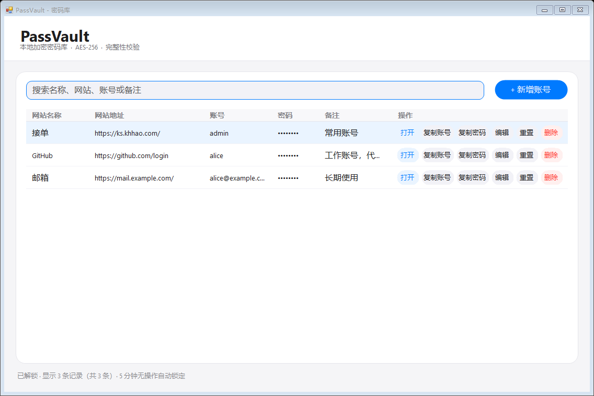
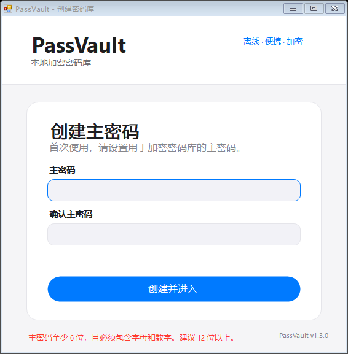
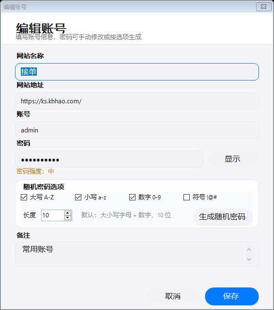
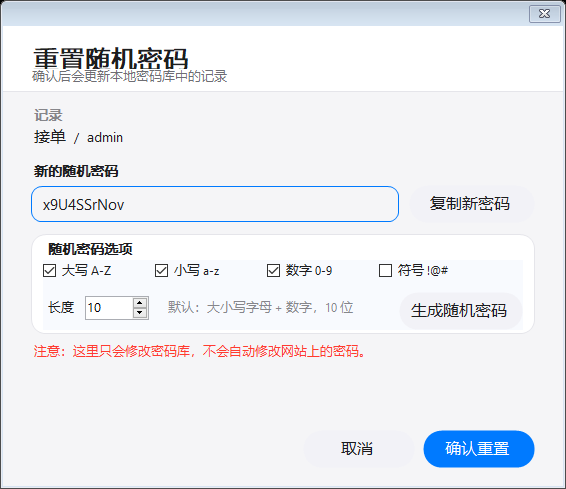

# PassVault 1.3.0

[GitHub 仓库](https://github.com/vokeers/PassVault) · [下载最新版本](https://github.com/vokeers/PassVault/releases/latest)

Windows 10/11 x64 下免安装的本地加密密码库，采用参考 Apple 风格的浅色界面：白色圆角卡片、表格化账号列表、蓝色操作按钮和圆角输入框。



## 功能

- 全宽账号表格，直接显示网站名称、网站地址、账号、密码、备注
- 最后一列提供完整操作：打开、复制账号、复制密码、编辑、重置、删除
- 密码列默认掩码显示，不在列表中展示明文
- 长网站地址和备注自动省略，鼠标悬停显示完整内容
- 保存网站名称、网站地址、账号、密码、备注
- 新增账号时默认生成强随机密码，也可手动修改
- 随机密码可勾选大写字母、小写字母、数字、符号，并设置长度
- **默认勾选：大写字母 + 小写字母 + 数字，长度 10 位**
- 保存时检查密码库内重复密码，重复密码直接阻止
- 点击“打开网站”或双击记录，使用默认浏览器打开
- 主密码解锁
- 5 分钟无操作自动锁定，也可以手动锁定
- 复制密码后 30 秒自动清空剪贴板
- 搜索网站名称、网站地址、账号和备注
- 加密文件保存，自动生成 `.bak` 备份
- 本地离线运行，无联网、无遥测

> 打开网站只会调用默认浏览器，不会自动填写账号密码。

## 主密码规则

主密码必须满足：

- 至少 **6 个字符**
- 必须同时包含 **字母** 和 **数字**
- 不能是 `123456`、`abcdef`、`abc123` 等连续/常见简单密码
- 不能是 `111111`、`aaaaaa` 等重复模式

建议主密码使用 12 位以上，或者使用四词短语。主密码越强，离线暴力破解的难度越高。

网站账号密码不受这条主密码规则限制，仍按你的实际网站要求填写。

## 界面预览

### 首次创建密码库



### 编辑账号



### 重置随机密码



## 随机密码

可选项：

- 大写字母 A-Z
- 小写字母 a-z
- 数字 0-9
- 符号 `!@#$` 等
- 长度 6–128 位

默认设置：

```text
大写字母：勾选
小写字母：勾选
数字：勾选
符号：不勾选
长度：10
```

生成密码时，保证每种已勾选字符类型至少出现一次。

## 安全设计

- 主密码不会保存到任何位置
- 创建密码库时生成 **32 字节随机盐**
- 主密码与随机盐通过 PBKDF2-HMAC-SHA256（300,000 次迭代）派生密钥
- 所有记录统一加密保存在密码库中，不保存单独的明文密码
- 使用 AES-256-CBC 加密
- 使用 HMAC-SHA256 做完整性校验
- 每次保存使用新的随机 IV
- 修改文件或输入错误主密码都会导致无法解密
- 密码库采用临时文件 + 原子替换写入
- 自动保留上一版 `vault.pvault.bak`
- 忘记主密码无法找回

## 数据文件

```text
PassVault/
  PassVault.exe
  使用说明.txt
  README.md
  TEST-REPORT.md
  vault.pvault       # 首次保存后生成
  vault.pvault.bak   # 保存前自动备份
  docs/screenshots/  # README 截图
```

迁移或备份时，关闭程序后复制整个文件夹。不要只复制 `vault.pvault` 而忽略 `.bak`。

恢复备份：

1. 关闭程序。
2. 把 `vault.pvault.bak` 改名为 `vault.pvault`。
3. 重新启动程序。

## 系统要求

- Windows 10/11 x64
- .NET Framework 4.8（Windows 10 1903+ 和 Windows 11 默认包含）

## 开发与构建

源码位于 `src\PassVault`。

在 Windows 上执行：

```powershell
powershell -ExecutionPolicy Bypass -File .\build.ps1
```

构建脚本会：

1. 使用 Windows 自带 .NET Framework 4.8 编译器编译程序
2. 运行内置自测
3. 生成 `dist\PassVault\PassVault.exe`
4. 生成 `release\PassVault-1.3.0-win-x64-portable.zip`

## 测试与优化

详细测试记录见 [TEST-REPORT.md](TEST-REPORT.md)。

已做的主要优化：

- 解锁和创建密码库的 PBKDF2 计算放到后台线程，避免界面假死
- 主界面改为全宽账号表格，所有字段直接展示
- 最后一列集中放置完整操作按钮
- 密码列默认掩码
- 长网址和备注省略显示，悬停显示完整内容
- 自绘表头、列表行、选中状态和操作胶囊按钮
- 搜索同时匹配网站名称、网站地址、账号和备注
- 保留加盐密钥派生、加密完整性校验和自动备份

## 安全边界

这是自研工具，不等同于经过第三方安全审计的商业密码管理器。

- 不能防止电脑中了木马、键盘记录器或屏幕录制工具
- 不能保证密码在“全网唯一”，只能保证当前密码库内不重复
- 重置密码只更新本地密码库，不会自动修改网站密码
- 不支持多设备同时编辑同一个密码库
- 未使用商业代码签名证书，首次运行可能出现 Windows SmartScreen 提示
- 如果保存的是非常重要、长期使用的账号，建议同时考虑 KeePassXC 便携版等成熟方案